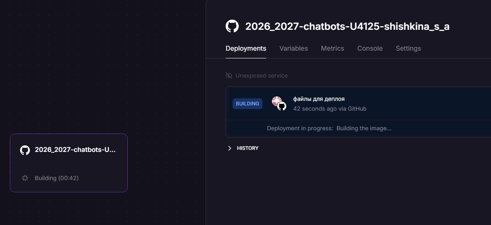
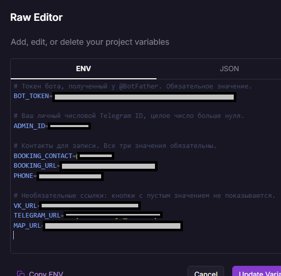
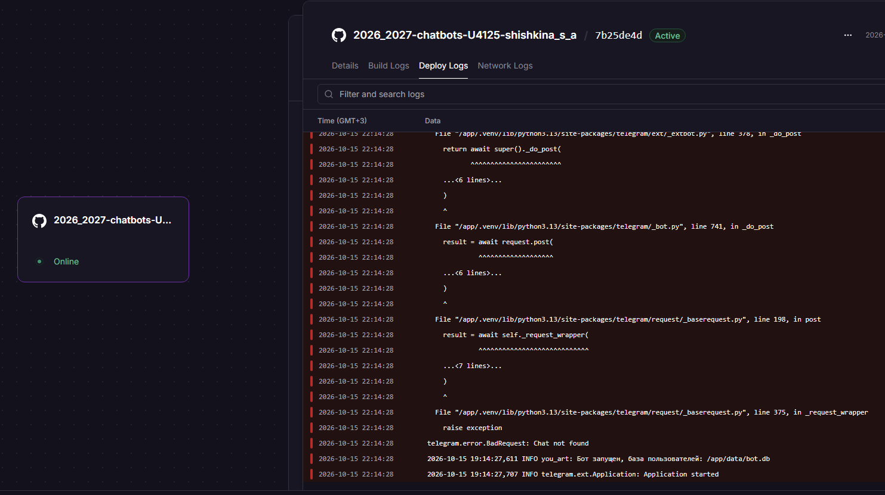
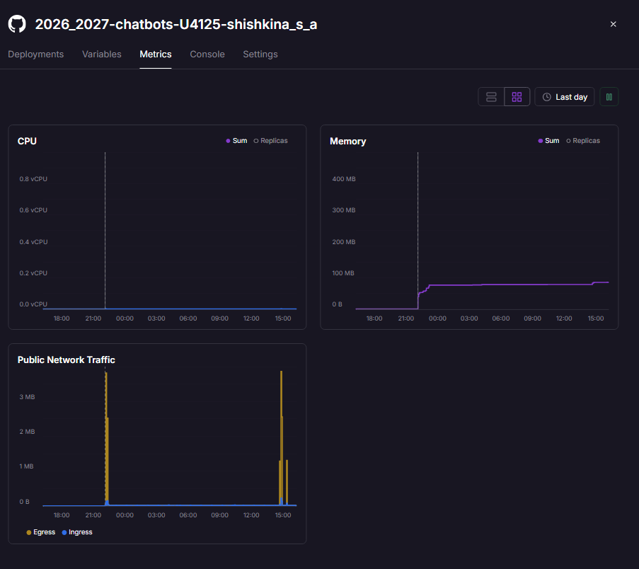
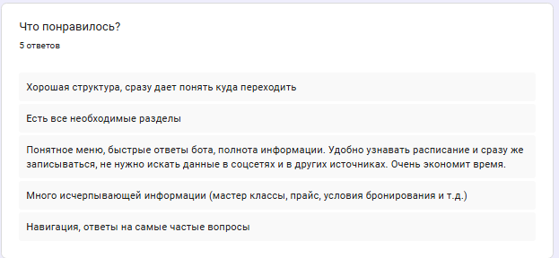
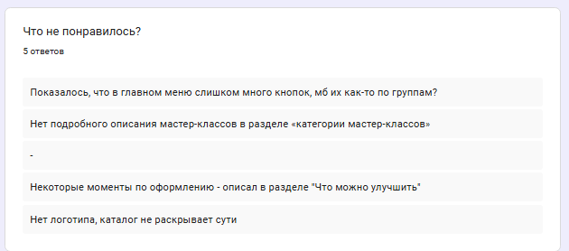
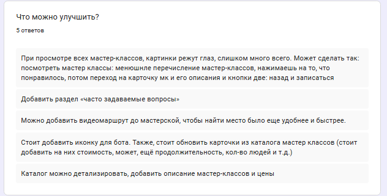
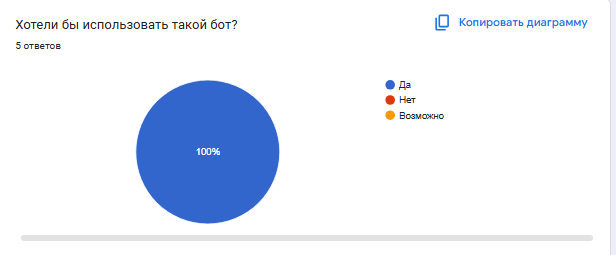

University: [ITMO University](https://itmo.ru/ru/)<br>
Faculty: [FTMI](https://ftmi.itmo.ru/)<br>
Course: [Vibe Coding: AI-боты для бизнеса](https://ex-itmo-ict-faculty.github.io/vibe-coding-for-business)<br>
Year: 2025/2026<br>
Group: U4125<br>
Author: Shishkina Sofya Anatolievna<br>
Lab: Lab3<br>
Date of create: 15.10.2026<br>
Date of finished: -<br>

# Описание

В этой лабораторной работе бот будет развёрнут так, чтобы им могли пользоваться реальные люди.

# Цель работы

Научиться деплоить бота и собирать обратную связь от реальных пользователей для улучшения продукта.

# Ход работы

## Шаг 1: Выбор способа деплоя

Выберем рекомендованный способ - Облачный хостинг (Railway).

## Шаг 2: Подготовка к деплою

- Создан `.env`-файл (на этапе Лаборатоной №1), где хранится в том числе токен бота.
- `requirements.txt` - уже есть
- логирование - уже есть:
```
LOGGER = logging.getLogger("you_art")
```

## Шаг 3: Деплой

- Авторизация на [Railway](https://railway.com) через GitHub.
- Выберем "Deploy from GitHub repo" и репозиторий `2026_2027-chatbots-U4125-shishkina_s_a`.
- Railway автоматически подхватил нужную папку:
  
- В разделе Variables добавим содержимое .env:
  
- Бот задеплоен:
  

## Шаг 4: Тестирование деплоя
- Бот работает
- Все функции работают: кнопки Каталога, Прайс, Афиша и так далее, а также функция /broadcast (отправка уведомлений пользователям).
- Видим логи после запуска:
```
2026-10-15 19:14:27,611 INFO you_art: Бот запущен, база пользователей: /app/data/bot.db
2026-10-15 19:14:27,707 INFO telegram.ext.Application: Application started
2026-10-15 19:26:34,648 INFO you_art: Рассылка: всего=2, успешно=2, ошибки=0
```
- метрики после 20 часов работы:
  
Память используется стабильно, сильно не растёт.

## Шаг 5: Сбор обратной связи

В Google-формах создан опрос, который на момент сдачи работы прошло 5 человек.

Ответы на вопрос "Что понравилось?":


Ответы на вопрос "Что не понравилось?":


Ответы на вопрос "Что можно улучшить?":


Ответы на вопрос "Хотели бы использовать такой бот?":


Для получения статистики использования можно сделать рассылку среди пользователей, а потом в логах Railways посмотреть, скольким людям ушли сообщения:

```
2026-10-15 19:26:34,648 INFO you_art: Рассылка: всего=7, успешно=7, ошибки=0
```

Получается, что рассылка пришла 7 зарегистрированным пользователям.

Примеры использования есть на видео по [этой](https://youtube.com/shorts/nmVE7td2HoU?feature=share) и [этой](https://www.youtube.com/shorts/66juRkCGFSo?feature=share) ссылке.

## Шаг 6: Улучшения на основе фидбека

1. Анализ отзывов

Что понравилось. Все 5 ответов положительные. Повторяются две темы:

- Навигация и структура упомянуты в 4 из 5 ответов: «понятное меню», «сразу даёт понять куда переходить».
- Полнота информации тоже в 4 из 5: прайс, условия бронирования, расписание. Один человек отдельно отметил, что бот экономит время: не нужно искать информацию в соцсетях.

Замечания. Если объединить ответы на вопросы «Что не понравилось?» и «Что улучшить?», получается 5 групп:

- в каталоге мастер-классов нет описаний, цен, длительности. Картинок слишком много сразу;
- нет логотипа и аватарки бота;
- в главном меню слишком много кнопок;
- нет раздела FAQ;
- нет видеомаршрута до мастерской.

2. Главные проблемы
   1. Каталог мастер-классов. Это самая частая жалоба. Сейчас бот присылает альбом из 12 картинок без текста. Пользователь видит фото, но не понимает, что это за мастер-класс, сколько он стоит и сколько длится. Один из тестировщиков сам предложил решение: сначала список названий, по нажатию открывается карточка с описанием, ценой и длительностью, а под ней кнопки «Назад» и «Записаться».
   2. Оформление бота. Нет аватарки и описания. Бот выглядит незавершённым и вызывает меньше доверия.
   3. Перегруженное меню. Пока это мнение одного человека, но после добавления FAQ кнопок станет ещё больше. Поэтому группировку лучше продумать сразу.


3. Приоритеты

  1. Переделать каталог: список названий → карточка (фото, описание, цена, длительность, размер группы) с кнопками «Назад» и «Записаться»
  2. Поставить аватарку, описание и «About» через @BotFather
  3. Сгруппировать главное меню, например «О мастерской» / «Мастер-классы и цены» / «Запись и контакты»
  4. Добавить раздел FAQ (его удобно положить в одну из групп меню)
   5. Видеомаршрут до мастерской

Видеомаршрут не затрагивает непосредственно разработку бота, поэтому этот вопрос будет оставлен на будущее.

4. Внесение изменений. 

Для этого написан такой промпт:

```
Внеси в бота (2026_2027-chatbots-U4125-shishkina_s_a\bot.py - основной файл) изменения:
1. Переделать каталог: список названий → карточка (фото, описание, цена, длительность, размер группы) с кнопками «Назад» и «Записаться»
2. Поставить аватарку, описание и «About» через @BotFather
4. Добавить раздел FAQ (его удобно положить в одну из групп меню)
```

Помимо этого боту была добавлена аватарка, а также добавлены новые карточки для каталога.
